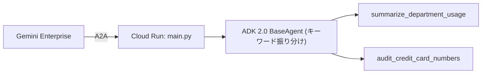

# サンプル 3: Cloud Run デプロイと Gemini Enterprise A2A 登録

サブテーマ 1 (利用量集計) とサブテーマ 2 (クレジットカード番号検出) のロジックを Agent Development Kit (ADK) 2.0 のルールベースエージェント (`BaseAgent`) として Cloud Run にデプロイし、Gemini Enterprise から Agent2Agent (A2A) プロトコルで呼び出す構成サンプルです。Cloud Run 内部では Gemini API を呼び出さないため、モデル推論の従量課金は発生しません。



## ファイル構成

| ファイル | 役割 |
| :--- | :--- |
| `audit_agent/agent.py` | Gemini API を使わずに集計とカード番号検出を実行する ADK 2.0 `BaseAgent` 定義 |
| `main.py` | `to_a2a(root_agent)` による A2A 準拠 ASGI エントリポイント |
| `Dockerfile` / `requirements.txt` | コンテナビルド設定 |
| `agent_card.template.json` | Gemini Enterprise 登録用 Agent Card テンプレート |
| `deploy_a2a.sh` | CSV のステージング、Cloud Run 非公開デプロイ、`agent_card.json` 生成を行うスクリプト |
| `test_a2a.sh` | Identity Token を使った Cloud Run エンドポイントの疎通確認スクリプト |
| `skills/credit-card-audit/SKILL.md` | Antigravity 用のカード番号検出規約 Skills サンプル |

## Antigravity へのプロンプト例

リポジトリ直下 `ge-ai-handson/` で起動した `agy` に以下を入力すると、コードを変更せずに Cloud Run へのデプロイや Skills の配置を行えます。実行中に `Allow sandbox bypass for command execution?` の確認が表示されたら承認してください (Cloud Shell の `gcloud` 認証情報を利用するためサンドボックス外で実行します)。

### Cloud Run へのデプロイと疎通確認

```text
コードは変更せず、samples/sample3_cloud_run_a2a/deploy_a2a.sh と samples/sample3_cloud_run_a2a/test_a2a.sh をサンドボックス外 (BypassSandbox: true) で順番に実行し、Cloud Run へのデプロイ、疎通確認、生成された samples/sample3_cloud_run_a2a/agent_card.json の内容表示まで完了させてください。
```

### Antigravity Skills の配置

```text
samples/sample3_cloud_run_a2a/skills/credit-card-audit/SKILL.md を .agents/skills/credit-card-audit/SKILL.md にコピーして配置を確認してください。
```

## ターミナルから直接 Cloud Run へデプロイする場合

`agy` を使わず Cloud Shell の通常ターミナル (上部の `+` アイコンで開いた新しいタブなど) から手動で実行する場合は、リポジトリ直下 `ge-ai-handson/` で以下を実行します。

```bash
bash ./samples/sample3_cloud_run_a2a/deploy_a2a.sh
```

`data/` の CSV 同梱、専用サービスアカウント `ge-agent-sa` の自動判定、`--no-allow-unauthenticated` での Cloud Run デプロイ、`samples/sample3_cloud_run_a2a/agent_card.json` の出力まで自動で実行されます。

Cloud Run エンドポイント単体での疎通を確認する場合は、続けて以下を実行します。

```bash
bash ./samples/sample3_cloud_run_a2a/test_a2a.sh
```

## Gemini Enterprise への登録

1. [Gemini Enterprise コンソール](https://console.cloud.google.com/gemini-enterprise/apps?hl=ja) で対象アプリを開き、左メニュー **エージェント** > **+ エージェントを追加** をクリックします。
2. **A2A によるカスタム エージェント** を選択し、`deploy_a2a.sh` が出力した `samples/sample3_cloud_run_a2a/agent_card.json` の内容を貼り付けます。
3. 認可設定は **スキップして終了** をクリックします。
4. 追加したエージェントの **ユーザー権限** タブで、対象ユーザーまたは Google グループに **エージェント ユーザー** (`roles/discoveryengine.agentUser`) を付与します。
5. Gemini Enterprise の Web アプリ画面を再読み込みし、左メニューの **エージェント** から追加したエージェントを選択して以下の質問を試します。

```none
部署別の生成AIリクエスト件数とトークン消費量、および未利用ユーザーを教えて
```

```none
クレジットカード番号が混入しているログID・部署を教えて
```

## ターミナルから Antigravity Skills を配置する場合

`skills/credit-card-audit/SKILL.md` をワークスペースの `.agents/skills/` 配下に置くと、Antigravity がデータ結合条件やカード番号の検出条件を自動で参照します (`agy` の起動中に配置した場合は `/skills reload` を実行するか新しい会話を開始して反映します)。

```bash
mkdir -p .agents/skills/credit-card-audit
cp samples/sample3_cloud_run_a2a/skills/credit-card-audit/SKILL.md .agents/skills/credit-card-audit/SKILL.md
```

## 補足: 別プロジェクトで試す場合の事前設定

ハンズオン用プロジェクトでは事前設定済みですが、持ち帰り後に別プロジェクトで試す場合は以下を設定してください。

- 事前に `run.googleapis.com`、`cloudbuild.googleapis.com`、`artifactregistry.googleapis.com`、`discoveryengine.googleapis.com` を有効化します。
- Gemini Enterprise アプリを作成したうえで、Gemini Enterprise からの呼び出しを許可するため対象 Cloud Run サービス (またはプロジェクト) で `service-<PROJECT_NUMBER>@gcp-sa-discoveryengine.iam.gserviceaccount.com` に `roles/run.invoker` を付与します (`deploy_a2a.sh` でも対象サービスへの自動付与を試みます)。
